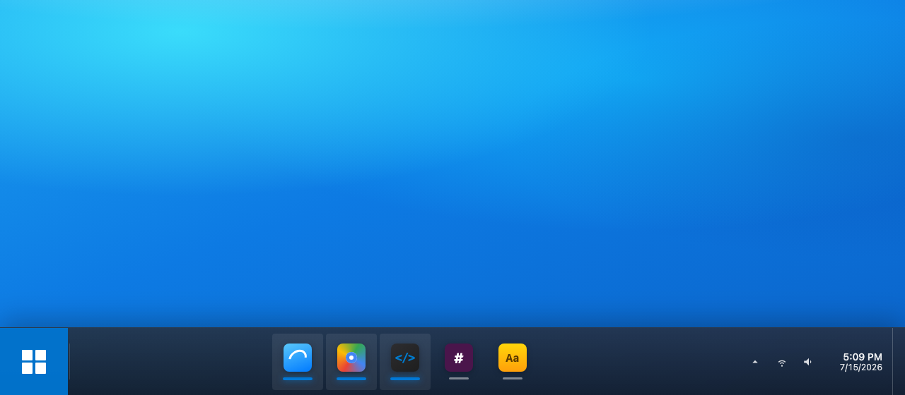

# Better Mac Taskbar



A Windows 10–style taskbar for macOS. Native Swift / AppKit accessory app (menu bar + bottom bar, no Dock required).

 

## Features

- Frosted-glass bottom taskbar
- Per-window icons (Chrome / multi-window apps show separately)
- Hover window previews with a close button; thumbnails when Screen Recording is granted (title cards otherwise, and on macOS 13)
- Dock badges (unread counts) on task buttons, and "Not responding" apps dimmed like on Windows
- Center or left-aligned icons
- Start menu with pinned apps and type-to-search across installed apps (configurable Start hotkey; default Windows / ⌘ alone unhides the taskbar)
- Clock, tray, Show Desktop
- Clock flyout shows Up Next: your next events for the coming week, like the Calendar widget (click one to open it in Calendar)
- Right-click: Close, Minimize, Pin, Hide, New window, Quit
- Middle-click closes a window
- Optional Dock replacement (Dock fully hidden while running; restored on quit)
- Optional auto-hide taskbar
- Launch at login (off until you turn it on in Settings)
- App log file for diagnosing unexpected quits (`~/Library/Logs/BetterMacTaskbar/app.log`), plus `scripts/bmt-log` for a live view and on-demand window snapshots

## Requirements

- macOS 13 or later
- Apple Silicon (arm64) — build script targets `arm64-apple-macosx`
- Xcode Command Line Tools (`xcode-select --install`)

## Install

**From a GitHub Release** (recommended): download the `.pkg` from [Releases](https://github.com/JosephAHK/better-mac-taskbar/releases), double-click, and follow Installer. Or use the `.dmg` and drag the app into Applications.

**From source:**

```bash
./package.sh            # builds → releases/
./package.sh --publish  # tag + upload to GitHub Releases (needs `gh`)
```

Distributable (Gatekeeper-friendly) installers need a **Developer ID Application** and a **Developer ID Installer** identity in your keychain, plus a notarytool profile:

```bash
xcrun notarytool store-credentials bmt-notary --apple-id … --team-id …
BMT_NOTARY_PROFILE=bmt-notary ./package.sh --publish
```

With those, `package.sh` signs with the hardened runtime, notarizes, and staples the app, `.pkg` and `.dmg`. Without them it still builds local installers but warns that Gatekeeper will block them, and `--publish` refuses unless you pass `--allow-unnotarized`. Publishing also refuses a dirty working tree or a version tag that already exists on another commit.

**Versioning:** `CFBundleShortVersionString` in `Resources/Info.plist` is the single source of truth for the version (and the release tag, `v<version>`) — bump it by hand for each release. `CFBundleVersion` is stamped into the built app by `build.sh` from `git rev-list --count HEAD`; the source plist's value is only a fallback outside git.

Then open **Better Mac Taskbar** from Applications and grant Accessibility (see below).

## Build & run (dev)

```bash
git clone https://github.com/JosephAHK/better-mac-taskbar.git
cd better-mac-taskbar
./build.sh
open "$(cat build/.run-app-path)"
```

`build.sh` compiles all Swift sources, packages an `.app` bundle, codesigns it with the hardened runtime (Apple Development identity if available, otherwise a stable local identity, otherwise ad-hoc), and installs it to `/Applications` (or `~/Applications`). `build/.run-app-path` records the installed copy — always run that one, not the intermediate bundle in `build/`, so macOS only ever sees one app with this bundle id.

The local signing identity lives in `~/Library/Application Support/BetterMacTaskbar/signing`, so deleting `build/` doesn't cost you your Accessibility grant.

## Permissions

Grant **Accessibility** in **System Settings → Privacy & Security → Accessibility**.

Use the menu bar icon → **Grant Accessibility…** if needed. Without Accessibility, the taskbar falls back to one icon per app instead of per window.

After a rebuild, macOS may keep the Accessibility toggle on but stop trusting the new binary — turn it **off then on** for Better Mac Taskbar, then choose **Refresh Windows**.

Automation permission may also be requested the first time the app raises or minimizes scriptable windows (e.g. Chrome).

## Settings

Menu bar icon → **Settings…**, or Start → Settings:

- Center taskbar icons
- Taskbar buttons: **Compact** (icons only) or **Wide** (icons with window titles, like Windows 10/11)
- Show window previews on hover. Thumbnails need **Screen Recording** (Settings → Permissions → Grant…); the app never asks for it on its own
- Hide Dock (use taskbar instead)
- Automatically hide the taskbar
- Start menu hotkey (uncheck to disable it entirely; click to record; Reset restores ⌘ / Windows key). Keys need ⌘, ⌥ or ⌃ unless they're F1–F20 or a modifier on its own.
- Launch at login (shows when it still needs approval in System Settings → Login Items)
- Reset to defaults

## Project layout

```
Sources/          Swift / AppKit source
Resources/        Info.plist, app icon
build.sh          Compile, package, sign
package.sh        Build .pkg + .dmg → releases/ (--publish uploads)
releases/         Local installers (gitignored binaries)
build/            Generated .app (gitignored)
```

## Logs

Runtime diagnostics are written to:

```
~/Library/Logs/BetterMacTaskbar/app.log
```

Useful when the app disappears after a rebuild (`pkill` + relaunch) or exits unexpectedly.

## License

MIT
